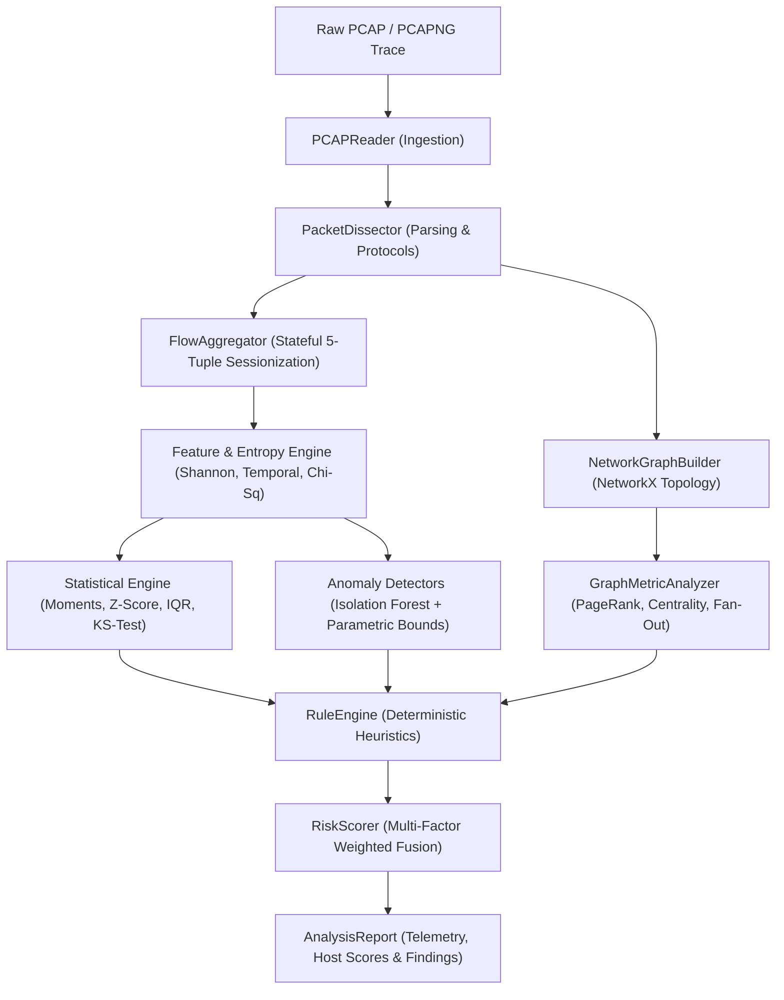

# IRONCLAD: Intelligent Network Telemetry & Cryptographic Defence Engine

[](https://www.python.org/downloads/)
[]()
[]()
[](LICENSE)

**IRONCLAD** is an enterprise-grade cybersecurity telemetry engine designed to process raw network packet captures, reconstruct high-dimensional communication flows, detect subtle statistical anomalies, analyze host communication graph topologies, and detect covert cryptographic channels or data exfiltration attempts.

This repository implements **Phase 1: The Core Python Network Analysis Engine**.

---

## 🏛 Architecture & Component Breakdown

The engine is engineered as a clean, modular pipeline where every stage is decoupled, typed, and independently reusable:



### Module Responsibilities

1. **`ironclad.ingestion`**:
   - Memory-bounded streaming reader for PCAP and PCAPNG captures using Scapy.
   - Batch generator for bulk processing large trace files without RAM exhaustion.
   - Magic byte validation and optional PyShark (`tshark`) integration.

2. **`ironclad.parsing`**:
   - Dissects Layer 2 (Ethernet, ARP), Layer 3 (IPv4, IPv6), and Layer 4 (TCP, UDP, ICMP).
   - Bitwise TCP flag dissection (`SYN`, `ACK`, `FIN`, `RST`, `PSH`, `URG`).
   - Normalizes raw frames into immutable `PacketSummary` dataclasses.

3. **`ironclad.features`**:
   - **Entropy Engine**: Evaluates Shannon Entropy ($0.0 \le H \le 8.0$), block entropy distributions, and Chi-Squared ($\chi^2$) uniformity tests to isolate encrypted ciphertext from structured plaintext.
   - **Temporal Engine**: Computes successive Inter-Arrival Times (IAT), packet jitter, and burstiness indices.
   - **Flow Aggregator**: Direction-agnostic 5-tuple canonical flow grouping with automatic export to Pandas DataFrames.

4. **`ironclad.stats`**:
   - Computes parametric and non-parametric moments (mean, variance, skewness, kurtosis, percentiles).
   - Outlier fence calculations (Tukey's IQR bounds, Gaussian Z-scores).
   - Baseline tracker supporting Kolmogorov-Smirnov (`ks_2samp`) distribution shift detection.

5. **`ironclad.anomaly`**:
   - Unsupervised machine learning via Scikit-Learn `IsolationForest`.
   - Parametric `ZScoreDetector` and non-parametric `IQRDetector`.
   - `HybridAnomalyDetector` ensemble combining model confidence and statistical fences.

6. **`ironclad.graph`**:
   - NetworkX-powered directed multigraph construction of IP-to-IP communications.
   - Computes PageRank, In/Out degree centralities, and clustering coefficients.
   - Calculates fan-out ratios $\frac{\text{out\_degree}}{\text{in\_degree} + 1}$ to uncover reconnaissance scans and botnet beacons.

7. **`ironclad.risk`**:
   - Deterministic cybersecurity heuristics (`SynScanRule`, `EncryptedExfiltrationRule`, `FanOutReconRule`).
   - Weighted multi-factor risk scoring engine synthesizing ML anomalies, topology, and rule violations into a normalized index $[0.0, 100.0]$ with severities (`LOW`, `MEDIUM`, `HIGH`, `CRITICAL`).

8. **`ironclad.pipeline`**:
   - Orchestrator facade (`IroncladEngine`) executing end-to-end audits from a single method call.

---

## 📐 Mathematical & Information-Theoretic Foundations

### 1. Shannon Entropy for Cryptographic Payload Detection
$$H(X) = -\sum_{i=0}^{255} p_i \log_2(p_i)$$
- **Plaintext / HTTP / JSON**: $3.0 \le H \le 5.2$ (highly structured byte distributions).
- **Encrypted / Compressed Streams (TLS, AES, ChaCha20)**: $7.4 \le H \le 8.0$ (uniform distribution across byte space).

### 2. Burstiness Parameter
$$B = \frac{\sigma_{IAT} - \mu_{IAT}}{\sigma_{IAT} + \mu_{IAT}} \in [-1, 1]$$
- $B = -1$: Perfectly periodic timing (automated beaconing).
- $B = 0$: Memoryless Poisson process.
- $B > 0$: Bursty traffic indicative of port sweeps or volumetric floods.

### 3. Fan-Out Asymmetry Ratio
$$\text{FanOut}(v) = \frac{\text{deg}^+(v)}{\text{deg}^-(v) + 1}$$
High values ($\ge 8.0$) combined with multiple unique destinations highlight horizontal reconnaissance sweeps.

---

## 📂 Proposed & Implemented Project Structure

```text
IRONCLAD_2/
├── .gitignore                          # Python, OS, PCAP, and test exclusion rules
├── pyproject.toml                      # Build configuration and pytest metadata
├── requirements.txt                    # Core engine dependencies
├── requirements-dev.txt                # Development and QA tools
├── README.md                           # Comprehensive documentation
├── docs/
│   └── WINDOWS_SETUP.md                # Dedicated Windows setup and Npcap guide
├── scripts/
│   ├── generate_synthetic_pcap.py      # Standalone synthetic PCAP test generator
│   └── run_engine.py                   # CLI runner for interactive PCAP auditing
├── ironclad/
│   ├── __init__.py                     # Package entry point
│   ├── pipeline.py                     # IroncladEngine unified pipeline facade
│   ├── core/
│   │   ├── __init__.py
│   │   ├── exceptions.py               # Strict typed exception hierarchy
│   │   ├── logging.py                  # Standardized structured logging
│   │   └── types.py                    # Dataclasses and enums (Packet, Flow, Risk)
│   ├── config/
│   │   ├── __init__.py
│   │   ├── default_config.yaml         # Production configuration profile
│   │   └── settings.py                 # Strongly-typed dataclass settings loader
│   ├── ingestion/
│   │   ├── __init__.py
│   │   └── pcap_reader.py              # Streaming PCAP/PCAPNG & PyShark readers
│   ├── parsing/
│   │   ├── __init__.py
│   │   ├── dissector.py                # Scapy frame dissecting & entropy preview
│   │   └── protocols.py                # Protocol & port mappings, TCP flag bitmasks
│   ├── features/
│   │   ├── __init__.py
│   │   ├── entropy.py                  # Shannon & block entropy calculations
│   │   ├── temporal.py                 # Inter-arrival times, jitter, and burstiness
│   │   └── flow_aggregator.py          # Stateful bidirectional sessionization
│   ├── stats/
│   │   ├── __init__.py
│   │   ├── distribution.py             # Moments, Z-scores, IQR bounds, KS-test
│   │   └── baseline.py                 # Historical baseline tracking & drift check
│   ├── anomaly/
│   │   ├── __init__.py
│   │   ├── detector.py                 # BaseAnomalyDetector & HybridEnsemble
│   │   ├── statistical.py              # ZScoreDetector & IQRDetector
│   │   └── isolation_forest.py         # Scikit-learn IsolationForest pipeline
│   ├── graph/
│   │   ├── __init__.py
│   │   ├── topology.py                 # NetworkX communication graph builder
│   │   └── metrics.py                  # Centralities, PageRank & fan-out analyzer
│   └── risk/
│       ├── __init__.py
│       ├── rules.py                    # Deterministic cybersecurity rule heuristics
│       └── scorer.py                   # Multi-factor composite risk engine
└── tests/
    ├── __init__.py
    ├── conftest.py                     # Shared Pytest fixtures and mocks
    ├── test_ingestion.py               # PCAP streaming and format tests
    ├── test_parsing.py                 # Dissector and flag bitmask tests
    ├── test_features.py                # Cryptographic entropy & timing tests
    ├── test_stats.py                   # Moments, Z-score, and baseline tests
    ├── test_anomaly.py                 # Statistical and IsolationForest tests
    ├── test_graph.py                   # Topology and metric tests
    ├── test_risk.py                    # Rules and composite risk scoring tests
    └── test_pipeline.py                # End-to-end integration test
```

---

## ⚡ Quickstart Guide (Windows)

### 1. Environment Setup
In PowerShell:
```powershell
# Navigate to project
cd E:\2030_PROJECTS\IRONCLAD_2

# Create virtual environment
python -m venv .venv

# Activate
.venv\Scripts\Activate.ps1

# Install dependencies
pip install -r requirements.txt
pip install -r requirements-dev.txt
pip install -e .
```

> For comprehensive details on Npcap and Wireshark/TShark, see [docs/WINDOWS_SETUP.md](docs/WINDOWS_SETUP.md).

### 2. Run Test Suite
```powershell
pytest -v
```
All 28 unit and integration tests will execute and validate:
- PCAP streaming and batching
- Frame parsing and bitwise TCP flag unpacking
- Information-theoretic entropy calculation
- Rolling baseline drift evaluation
- Isolation Forest anomaly training and scoring
- Directed topology generation and PageRank
- Cybersecurity rule triggers
- End-to-end telemetry auditing

### 3. Run the Engine CLI
Generate a sample multi-vector attack trace (normal HTTP/DNS + SYN port scan + encrypted exfiltration) and run the engine:

```powershell
python scripts/run_engine.py --generate-synthetic
```

To audit any existing PCAP capture:
```powershell
python scripts/run_engine.py --pcap path/to/capture.pcap
```

---

## 💻 Python API Usage

```python
from ironclad.config.settings import EngineConfig
from ironclad.pipeline import IroncladEngine

# 1. Initialize configuration (loads defaults or custom YAML)
config = EngineConfig.default()

# 2. Instantiate pipeline engine
engine = IroncladEngine(config=config)

# 3. Analyze capture file
report = engine.analyze_pcap("data/sample_traffic.pcap")

# 4. Inspect telemetry and findings
print(f"Packets Processed: {report.total_packets}")
print(f"Flows Identified : {report.flow_count}")
print(f"Global Risk Score: {report.global_risk.score}/100.0 [{report.global_risk.severity.value}]")

for finding in report.global_risk.findings:
    print(f"[{finding.severity.value}] {finding.rule_name} on {finding.target_entity}")
    print(f" -> {finding.description}")
```
